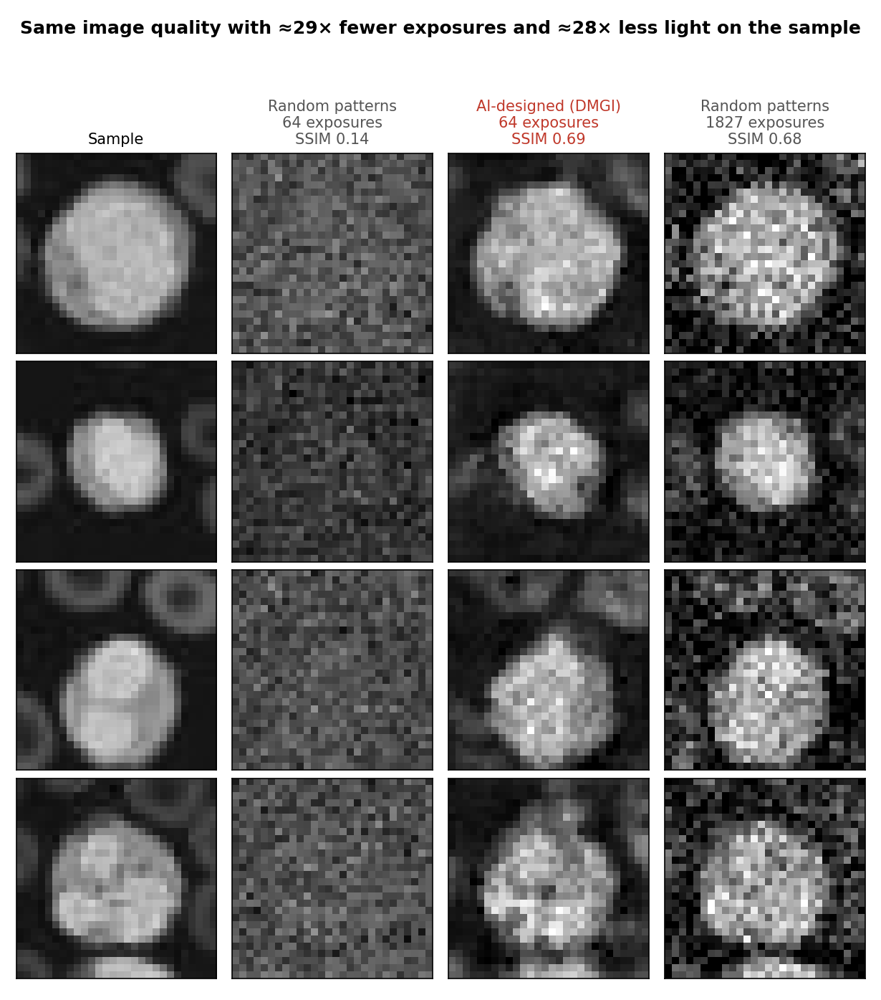
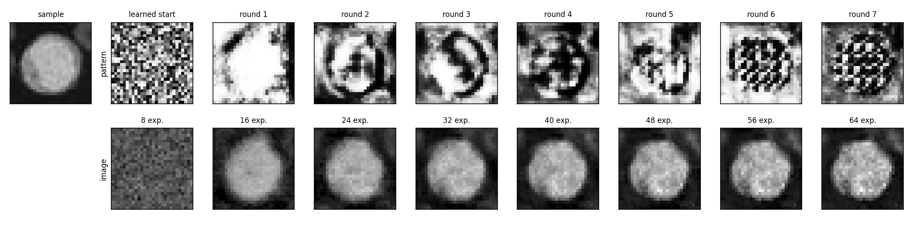
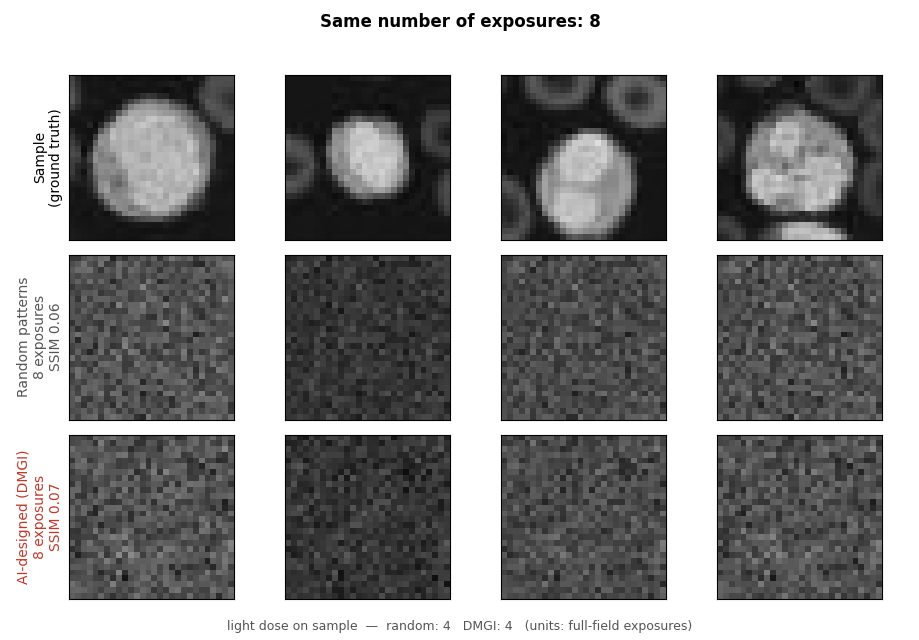
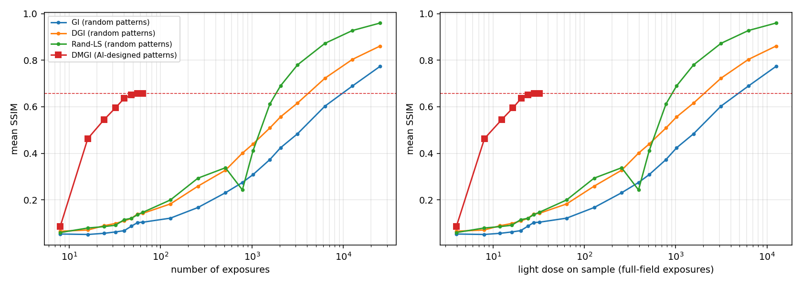

# GhostLight: Low-Dose Imaging for Drug Discovery

**Same image, 28× less light.** GhostLight uses AI-designed illumination patterns for single-pixel (ghost) imaging, so living cells can be imaged with far fewer light exposures.



## Why it matters
In drug discovery, scientists film living cells for hours or days to see how they respond to a compound. But imaging light damages cells (**phototoxicity**) and fades fluorescent labels (**photobleaching**). Light damage can be mistaken for drug toxicity, and it limits how long and how often cells can be imaged. Less light means healthier cells and more reliable drug-response data.

## How ghost imaging works
A normal camera has millions of pixels. Ghost imaging (single-pixel imaging) uses **one** detector that measures only the **total** brightness. A programmable device (DMD) projects a known light pattern onto the sample, and the detector records one number. Repeat with many patterns, and a computer reconstructs the image:

```
b_m = sum_x P_m(x) * O(x)      (P_m: m-th pattern, O: unknown image, b_m: detector reading)
```

Single-pixel detectors are very sensitive, so the technique works in low light. The catch: with **random** patterns it needs thousands of exposures, and the total light on the cells adds up.

## Our method: DMGI
Instead of random patterns, a neural network decides where to shine the light, round by round:

1. **Round 0:** 8 starting patterns (learned from data) → 8 detector readings → blurry least-squares reconstruction.
2. **Rounds 1–7:** a small U-Net (with a round embedding, inspired by the iterative refinement of diffusion models) looks at the current reconstruction and designs the next 8 patterns **for this specific sample** → measure → reconstruct again.
3. After 8 rounds (64 exposures), the image is sharp.

The network never sees the true image, only the detector readings. The whole pipeline (patterns → readings → reconstruction) is differentiable, so the pattern generator is trained end-to-end on final image quality.



*Round 1 concentrates light on the cell; later rounds probe its internal structure.*

## Results
Simulation on BloodMNIST blood-cell microscopy images (28×28, inverted to look like fluorescence images), 4,800 training and 200 unseen test images.

| | Exposures | Mean SSIM |
|---|---|---|
| Random patterns (same reconstructor) | 64 | ~0.14 |
| **DMGI (AI-designed patterns)** | **64** | **~0.66** |
| Random patterns, to match DMGI | 1,827 | ~0.66 |

- **29× fewer exposures and 28× less light** than random patterns with the same reconstruction algorithm.
- Classic ghost imaging needs about 64× (DGI) to 151× (GI) more exposures.





**Fair comparison:** the Random+LS baseline uses exactly the same reconstruction algorithm as DMGI, so the gain comes from the patterns alone. Light dose is computed from the actual brightness of every pattern, not just the number of exposures.

## Run it
```bash
pip install numpy matplotlib scikit-image scikit-learn torch torchvision medmnist certifi

python dmgi.py --epochs 1 --n_train 256 --n_test 50   # smoke test (1-2 min)
python dmgi.py --loss ssim                            # main run (~25 min on a laptop CPU)
python demo.py --run runs/bloodmnist_ssim             # demo animation and figures
python cgi_basic.py                                   # classic ghost imaging, for comparison
```

| File | Purpose |
|---|---|
| `dmgi_core.py` | Differentiable imaging simulation, light-dose metric, U-Net, DMGI loop, losses |
| `dmgi.py` | Training, evaluation, comparison with baselines, figures and `results.json` |
| `baselines.py` | Random-pattern baselines: GI, DGI, Random + least squares |
| `demo.py` | Demo animation (`demo.gif`) and summary figures from a trained model |
| `cgi_basic.py` | Classic computational ghost imaging with random patterns |
| `data_utils.py` | Dataset loading (MedMNIST / MNIST), SSIM and PSNR |

## Limitations and next steps
- All results are from simulation; next is a physical DMD prototype.
- Patterns are grayscale; real DMDs are fastest with binary (on/off) patterns.
- Noise model is simplified; next is a photon-noise model and comparison at equal photon budget.
- Higher resolution and real fluorescence images of drug-treated cells.

## Credits
- The method builds on my earlier research paper on diffusion-model-based light-pattern optimization for ghost imaging. The code, experiments, and biomedical application in this repository were built during the Solix AI Hackathon 2026.
- Data: MedMNIST v2 (Yang et al., *Scientific Data*, 2023), CC BY 4.0.
